  

  
  
  
  
  

  
  
  
  
  

  <a href="#-english-overview"><b>English Overview</b></a> &nbsp;•&nbsp; <a href="#-t%C3%BCrk%C3%A7e-tan%C4%B1t%C4%B1m"><b>Türkçe Tanıtım</b></a>

---

## 🏛️ English Overview

### About Vellium
**Vellium** is an independent software studio developing AI-assisted productivity, workflow, and knowledge management systems. We design digital tools that make daily work for individuals and organizations more organized, sustainable, and manageable. 

Rather than producing disconnected tools for fleeting trends, we engineer software systems with their own product identity, controlled dependencies, and sustainable evolutionary roadmaps.

> *"We build digital systems that create lasting value."*

---

### 🎯 Vision & Mission

* **Vision:** To develop reliable systems that eliminate clutter, repetitive burden, and information loss while naturally integrating into daily workflows. In the long term, establishing industry-defining standards for how digital products should be architected, built, and operated.
* **Mission:** To develop software systems that do not deplete user attention, do not restrict human agency, and do not treat user data as commercial merchandise. Synthesizing artificial intelligence, automation, and modern software engineering so organizations work with clarity, preserve knowledge, and make decisions within a resilient context.

---

### ⚖️ Core Operating Principles

1. **Human Agency:** Technology must empower user decision-making rather than usurping authority. High-impact operations preserve final human judgment.
2. **Operational Resilience:** Systems must perform reliably not only under ideal conditions, but under real-world continuous load, network variability, and evolving operational demands.
3. **Measured AI:** Artificial intelligence is positioned strictly as a contextual capability layer that generates concrete, measurable value—never as synthetic gimmickry.
4. **Data Responsibility & Independence:** User data is processed strictly to the extent required. Architectures are engineered to prevent vendor lock-in and ensure portable sovereignty.
5. **Aesthetic Simplicity & Continuity:** Interfaces that declutter cognitive load, clarify function, and remain intuitive, fast, and sustainable across years of daily use.

---

### ⚡ Product Ecosystem

* 🌐 **[Operis](https://vellium.dev):** Autonomous operations, workflow synthesis, and enterprise-grade execution intelligence.
* 🧠 **[Continuum](https://vellium.dev):** Knowledge memory, deep context retention, and interconnected research infrastructure.
* 📦 **[Tecton](https://vellium.dev):** Offline-first autonomous workforce, ledger, and progress billing management engine.
* 🔗 **[Suppleo & Velox](https://vellium.dev):** High-speed microservice pipelines and resilient multi-point resource coordination.

---

 

## 🇹🇷 Türkçe Tanıtım

### Vellium Hakkında
**Vellium**, yapay zekâ destekli üretkenlik, iş akışı ve bilgi yönetimi ürünleri geliştiren bağımsız bir yazılım şirketidir. İnsanların ve kurumların günlük çalışmalarını daha düzenli, sürdürülebilir ve yönetilebilir hâle getiren dijital sistemler tasarlıyoruz.

Faaliyet alanımız, geçici eğilimler doğrultusunda birbirinden kopuk projeler üretmekten ziyade; belirli problemleri derinlemesine inceleyen, kendi ürün kimliğine ve sürdürülebilir teknik omurgasına sahip yazılım sistemleri oluşturmaktır.

> *"Kalıcı değer üreten otonom dijital sistemler geliştiriyoruz."*

---

### 🎯 Vizyon & Misyon

* **Vizyonumuz:** İnsanların ve kurumların dijital araçlarla çalışırken karşılaştığı dağınıklığı, tekrar eden iş yükünü ve bilgi kaybını azaltan; günlük iş akışlarına doğal biçimde entegre olan güvenilir sistemler geliştirmek. Dijital ürünlerin nasıl tasarlanması, geliştirilmesi ve işletilmesi gerektiğine dair güçlü standartlar ortaya koymak.
* **Misyonumuz:** Kullanıcının dikkatini tüketmeyen, kontrolünü sınırlandırmayan ve verisini bir ticari kaynak olarak görmeyen yazılım ürünleri geliştirmek. Yapay zekâ, otomasyon ve modern yazılım mühendisliğini bir araya getirerek insanların daha düzenli çalışmasını, bilgilerini korumasını ve kararlarını sağlam bir bağlam içinde almasını sağlamak.

---

### ⚖️ Çalışma İlkeleri

1. **İnsan Kontrolü:** Teknoloji, kullanıcının karar verme yetkisini devralmak yerine onu desteklemelidir. Kritik kararlarda nihai otorite daima insana aittir.
2. **Operasyonel Dayanıklılık:** Sistemler yalnızca ideal koşullarda değil, gerçek kullanım yükü ve değişen operasyonel ihtiyaçlar altında da güvenilir ve kesintisiz çalışmalıdır.
3. **Ölçülü Yapay Zekâ:** Yapay zekâ, görünür ve somut bir fayda üretmediği hiçbir alana yalnızca yenilik izlenimi oluşturmak amacıyla eklenmez.
4. **Veri Sorumluluğu ve Bağımsızlık:** Toplanan her veri için açık bir gereklilik ve saklama modeli bulunur; sistemler tek bir sağlayıcıya bağımlı kılınmayacak şekilde taşınabilir kurulur.
5. **Estetik Sadelik ve Süreklilik:** Arayüzler dikkat dağıtmak yerine bilgiyi düzenler, işlevi görünür kılar ve yıllar boyu sürecek günlük kullanımda tutarlılığını korur.

---

### ⚡ Ürün ve Teknoloji Ekosistemi

* 🌐 **[Operis](https://vellium.dev):** Yeni nesil otonom operasyon, iş akışı ve kurumsal süreç yönetim platformu.
* 🧠 **[Continuum](https://vellium.dev):** Bilgi ve çalışma hafızası, derin bağlam koruma ve araştırma altyapısı.
* 📦 **[Tecton](https://vellium.dev):** Çevrimdışı öncelikli (offline-first) kurumsal iş gücü, hak ediş ve kasa yönetim sistemi.
* 🔗 **[Suppleo & Velox](https://vellium.dev):** Yüksek hızlı mikroservis omurgaları ve çok noktalı kaynak koordinasyon motorları.

---

  © Vellium. All rights reserved. &nbsp;·&nbsp; Intelligent · Reliable · Enduring

